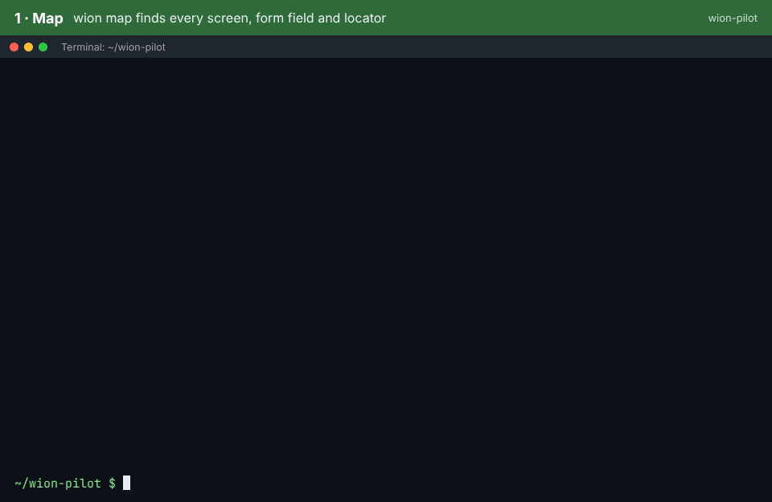
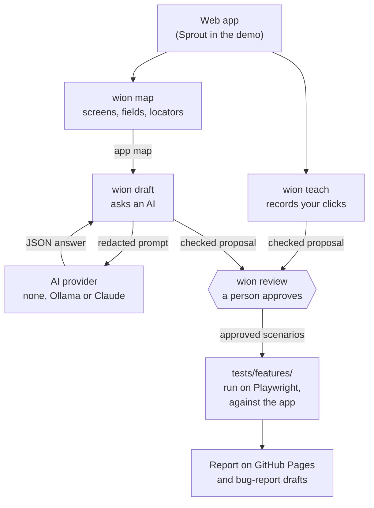

# Wion-Pilot

[](https://github.com/hoopsmax/wion-pilot/actions/workflows/ci.yml?query=branch%3Amain)
[](LICENSE)
[](https://hoopsmax.github.io/wion-pilot/)

AI-assisted test automation for web apps, built with TypeScript and Playwright.

End-to-end tests are slow to write by hand. An AI writes them fast, but not always right. Wion-Pilot combines both and keeps a person in charge: it maps a web app's screens, records a scenario while you click through the app, and lets an AI draft more, but nothing enters the test suite until a person approves it. The tests are plain-language Gherkin running on Playwright, and every failure comes with a bug-report draft to check before filing.

Everything is shown on **Sprout**, a small made-up plant-care app with the flows that are hardest to test: offline mode, and two people editing the same plant. The [latest test report](https://hoopsmax.github.io/wion-pilot/) from `main` is online.



*Real runs on the demo app, about 50 seconds: `wion map`; `wion teach`, with Playwright playing the person; `wion draft` with Claude, then `wion review`.*

## What it does

- **Map** (`wion map`): crawls the app and writes down every screen, its form fields and their rules, with a Playwright locator for each button, link and field. It never clicks, types or submits anything apart from signing in. [More](docs/map.md)
- **Teach** (`wion teach`): you click through the app in a browser, and each action becomes a step of a Gherkin scenario. No AI, no cost. [More](docs/teach.md)
- **Draft and review** (`wion draft`, `wion review`): an AI drafts scenarios from a topic or a code change, using only steps that already exist; a made-up step is refused. A person approves each scenario. [More](docs/ai-drafts.md)
- **Bug-report drafts:** every failing test writes a draft with the steps, expected and actual, a screenshot, video and trace, and the browser's console errors and failed requests. [More](docs/bug-reports.md), or see [an example](docs/example-bug-report.md)
- **The BDD suite:** offline sync, two people editing the same plant in two browsers, and reminders with a fixed clock. Each test makes and removes its own data, so the suite runs in parallel, in CI on every push. [More](docs/test-suite.md), and [about Sprout](docs/sprout.md)

## Quickstart

You need git and Node.js 26 (pinned in `.nvmrc`).

```bash
git clone https://github.com/hoopsmax/wion-pilot.git
cd wion-pilot
nvm install
npm ci
npx playwright install chromium
npm test
npx playwright show-report
```

`npm test` starts its own copy of Sprout, with its own data, and runs the whole suite. The last command opens the report.

<details>
<summary>Your terminal says <code>nvm: command not found</code>?</summary>

Install nvm first (macOS with zsh shown; the nvm installer only adds itself to a shell settings file that already exists):

```bash
touch ~/.zshrc
curl -o- https://raw.githubusercontent.com/nvm-sh/nvm/v0.41.0/install.sh | bash
```

Then close the terminal window, open a new one, and run the steps above. With fnm, use `fnm use` instead of `nvm install`.

</details>

Then try the tools on the demo app. Start Sprout in one terminal (it runs at http://localhost:4600):

```bash
npm run demo
```

In a second terminal:

```bash
npm run map:sprout                                    # map the screens, then open .wion/map/index.html
npm run teach:sprout -- "Adding a plant by clicking"  # record a scenario by clicking
npm run wion -- draft "watering reminders"            # no AI by default: writes a prompt to paste into any chat
npm run wion -- review                                # approve or reject what was recorded or drafted
```

`npm run demo:reset` restores the demo data at any time.

## Architecture



- **`wion map`** writes `.wion/map/app-map.json`. `wion draft` sends a summary of it, so the AI knows the screens and fields.
- **`wion teach` and `wion draft`** both write a proposal, and `bddgen` checks its steps against the shared steps. A proposal with a made-up step is never offered for review.
- **`wion review`** is the only way into `tests/features/`.
- **`npm test`** generates the tests with playwright-bdd and runs them on Playwright. Each failure writes a bug-report draft, and CI publishes the report from `main` to GitHub Pages.
- **Every AI call** is logged with its tokens, time and estimated cost in `.wion/ledger.jsonl`.

The code: `packages/core/src/` has one folder per area (`map`, `teach`, `draft`, `report`, `shared`), `packages/cli/` is the `wion` command, `apps/sprout/` is the demo app, and `tests/` holds the suite (features, shared steps, page objects, fixtures). [PLAN.md](PLAN.md) has the full layout.

## Design decisions

**Locators by role and label, not CSS or XPath.** A locator like `getByRole('button', { name: 'Save' })` uses the name a person sees, so it survives changes to classes and markup, and it reads like the step it serves. The map, the generic steps (`Ava clicks "Save"`) and the recordings all use these same names. An element without an accessible name gets no locator but a note in the map: a screen-reader user would miss it too. Lint forbids XPath, and CSS is allowed only with a comment that says why.

**Plain JSON files instead of a database.** Sprout keeps all its data in one JSON file. It is written atomically (a temporary file, then a rename), and changes are applied one at a time, so two edits never both turn version 3 into version 4. Resetting the demo is a file copy, and the test suite runs its own Sprout on its own copy. Wion's output is plain files too: the app map, the proposals and the ledger. There is nothing to install, and any state can be opened and read. The trade-off is scale: this suits a demo with small data and one server, not production.

**Nothing generated enters the suite without a person.** AI drafts and recordings both wait in `.wion/proposals/` and reach `tests/features/` only through `wion review`. Checks alone are not enough: the first real AI draft passed the step check, yet two of its five scenarios failed when run, because they changed a field without opening the form first. So review shows every scenario, and it prints the command to run the approved ones before you commit them.

**No AI by default.** The default provider is `none`: wion writes the prompt to a file that you can paste into any chat. It costs nothing and sends nothing anywhere. Ollama keeps everything on your computer, and Claude is opt-in, with a key in `.env`. With any provider, the prompt is redacted first (email addresses and secrets), and every call is logged.

**Tests own their data and never wait blindly.** Each scenario creates plants named `wion-test-…` and deletes them afterwards, so the suite runs in parallel and in any order. There are no fixed waits: every step waits for something its action caused. When a test flaked, the cause was found and fixed, not hidden behind a longer timeout. For example, a conflict scenario failed in CI now and then. The screenshots of one failure showed the two changes reaching the server in the wrong order. The test's save step waited for the Save button to go, but the app only renames it "Saving…", so the test went on before the change was even queued. With the save slowed down on purpose, the old step failed 5 times out of 5, and the fixed one passed every time.

## How it was built

I built Wion-Pilot with Claude Code, Anthropic's coding agent: I set the rules ([CLAUDE.md](CLAUDE.md)) and the roadmap ([PLAN.md](PLAN.md)), approved every plan, and ran and checked each milestone myself.

## Commands

| Command | What it does |
| --- | --- |
| `npm run demo` | Build Sprout and start it at http://localhost:4600. |
| `npm run demo:reset` | Restore Sprout's seed data. Works while the demo is running. |
| `npm run map:sprout` | Map the running Sprout (signed in as Ava) into `.wion/map/`. See [Map an app](docs/map.md). |
| `npm run wion -- map <url>` | Map any web app. `npm run wion -- --help` lists the options. |
| `npm run wion -- draft "<topic>"` | Let an AI draft scenarios for review. See [AI drafts](docs/ai-drafts.md). |
| `npm run wion -- review` | Approve or reject drafted or recorded scenarios, one by one. |
| `npm run teach:sprout -- "<scenario>"` | Record a scenario in Sprout by clicking, signed in as Ava. See [Teach mode](docs/teach.md). |
| `npm run wion -- teach <url> "<scenario>"` | Record a scenario in any web app. |
| `npm run demo:bug` | Run one scenario that fails on purpose and write its bug-report draft. npm reports a failure: that is the demo. |
| `npm run check` | Lint (ESLint and Prettier), typecheck and unit tests. Run it before every commit. |
| `npm run format` | Format all files with Prettier. |
| `npm test` | Generate the tests from the `.feature` files (`bddgen`), then run Playwright. |
| `npx playwright show-report` | Open the last HTML report. |

Lint also enforces some of the test rules: no fixed waits (`waitForTimeout`), no XPath locators, and no source file over 300 lines.

## Roadmap

The milestones from [PLAN.md](PLAN.md):

- **M0:** the tooling: strict TypeScript, ESLint and Prettier, Vitest, Playwright with playwright-bdd, CI on GitHub Actions ([#1](https://github.com/hoopsmax/wion-pilot/pull/1))
- **M1:** Sprout, the demo app ([#2](https://github.com/hoopsmax/wion-pilot/pull/2))
- **M2:** the hand-written BDD suite ([#3](https://github.com/hoopsmax/wion-pilot/pull/3))
- **M3:** bug-report drafts ([#4](https://github.com/hoopsmax/wion-pilot/pull/4))
- **M4:** `wion map` ([#5](https://github.com/hoopsmax/wion-pilot/pull/5))
- **M5:** `wion draft` and `wion review` ([#6](https://github.com/hoopsmax/wion-pilot/pull/6))
- **M6:** `wion teach` ([#7](https://github.com/hoopsmax/wion-pilot/pull/7), [#8](https://github.com/hoopsmax/wion-pilot/pull/8))
- **M7:** portfolio polish: this front page and the demo GIF ([#9](https://github.com/hoopsmax/wion-pilot/pull/9), [#10](https://github.com/hoopsmax/wion-pilot/pull/10))

## License

MIT. See [LICENSE](LICENSE).
